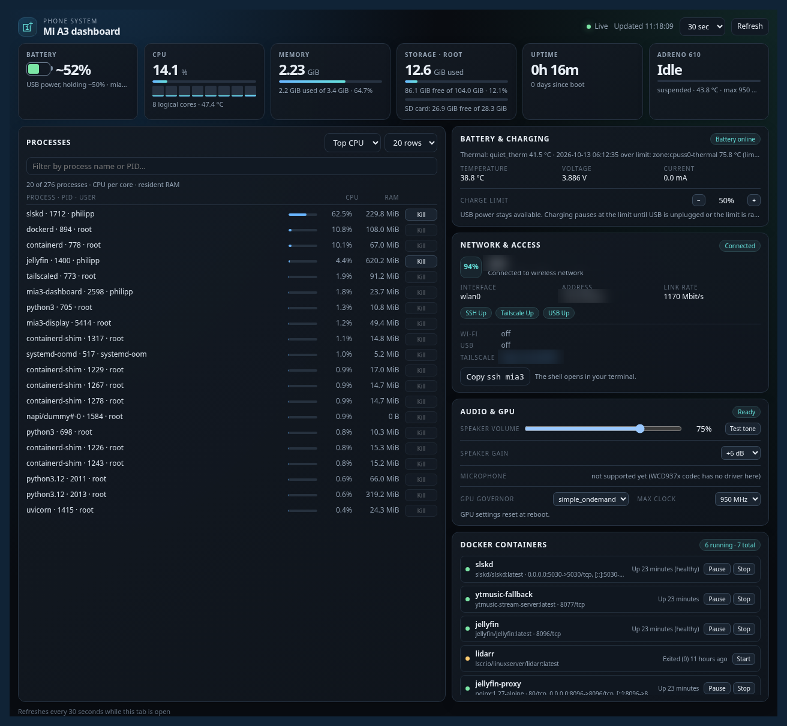
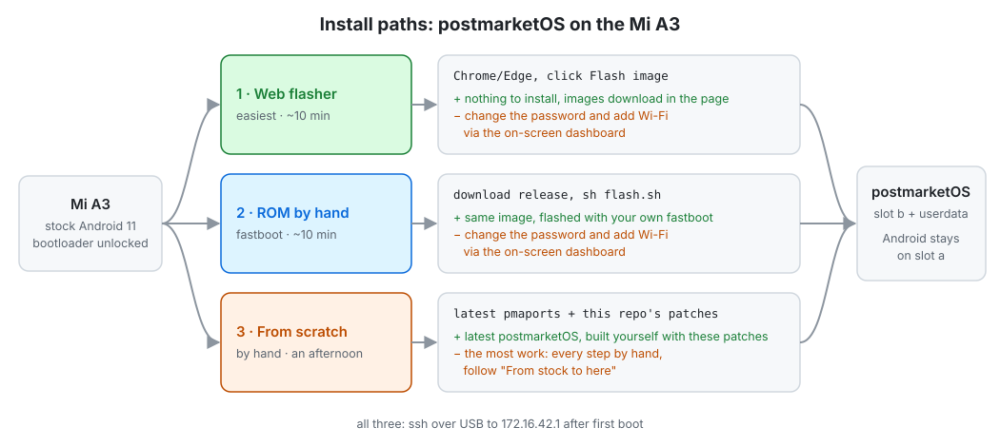

# Xiaomi Mi A3 (M1906F9SH, laurel_sprout, SM6125) on postmarketOS

A Xiaomi Mi A3 (model M1906F9SH, codename `laurel_sprout`, SoC SM6125) running postmarketOS edge as a headless home server with a touch dashboard on its own screen.
Tested on kernel `linux-nura-qcom-sm61x5` 7.2.3, booting slot b. No warranty: back up your boot image first.

**Web flasher:** [philipplinux.github.io/mia3-postmarketos](https://philipplinux.github.io/mia3-postmarketos/) · **Images:** [GitHub release](https://github.com/philipplinux/mia3-postmarketos/releases/latest), [Hugging Face](https://huggingface.co/PhilippLinux/mia3-postmarketos)

**Discussion:** [XDA thread](https://xdaforums.com/t/linux-nura-postmarketos-mi-a3-as-a-linux-mainline-7-2-home-server-battery-wi-fi-bt-ir-gpu-speaker-touch-dashboard.4804894/) · [r/mobilelinux](https://www.reddit.com/r/mobilelinux/comments/1x4u0l2/xiaomi_mi_a3_mainline72_on_nura_postmarketos/)


[](https://www.buymeacoffee.com/philipplinux)

 

Web dashboard (port 8090):



## Status

| Feature | State | Notes |
|---|---|---|
| Display, touch | working | framebuffer UI (`display/`), ft5x06 touch, power-key cycle dashboard / tty1 / off |
| Battery | working | `mia3-qg` fuel gauge driver (PMI632 QG: %, current, voltage), `pmi632_chg` charge limit (hold at 50 %) |
| Wi-Fi | working | WCN3990 (ath10k), needs the MPSS modem firmware to boot |
| Bluetooth | working | WCN3988, on-screen pairing |
| IR blaster | working | `ir-spi-led`, remote on the Network page |
| GPU | working | Adreno 610 (freedreno), governor and max clock from both dashboards |
| Audio (bottom speaker) | working | MAX98937 amp via ADSP runtime overlays, volume/gain, chimes |
| CPU frequency, temperatures | working | cpufreq-hw, TSENS + ADC thermal zones, thermal guard |
| Dashboards | working | on-screen (6 tabs) and web (port 8090) |
| microSD, USB networking, ssh, Tailscale, Docker | working | |
| Modem | half configured | MPSS boots (Wi-Fi needs it), rmtfs/qrtr run; no calls, SMS or data set up |
| Earpiece, microphones | untested, unconfigured | need WCD937x + LPASS macros + SoundWire (all off in the kernel config) |
| GPS | untested, unconfigured | needs a QMI LOC userspace client |
| Fingerprint | not attempted | |
| Cameras | no | |

## Changelog

### Unreleased — 2026-10-15

- **SSH account rename:** on the phone, open Network → SSH, tap the username, enter a new name and tap **Rename account**. The account keeps its UID, home directory, password and SSH keys; console autologin follows the new name. Tap the username again or Back to cancel. Use the new username for subsequent SSH connections (update any saved SSH client configuration).
- Username validation, duplicate-name checks and rollback on console-autologin update failure are covered by the display selftest.
- Userspace display update only; no kernel or release image rebuild. Existing published images do not include this change yet.

## Three ways to install



All three start from an unlocked Mi A3 on stock Android 11 (step 1 of "From stock to here"; unlocking wipes the phone)
and flash slot b + `userdata`, leaving stock Android on slot a.

| Path | You need | Time | Result |
|---|---|---|---|
| **3. Generic ready build (easiest)** | fastboot or the web flasher (Chrome/Edge) | ~10 min | Download and flash. Requires a credential update: log in as `user` / `changeme`, change the password and add Wi-Fi via the on-screen dashboard |
| 2. Docker build | Docker | ~1 h first run | Built with your own credentials, parameters and keys (user, password, SSH key, Wi-Fi) |
| 1. From scratch | pmbootstrap, a kernel tree | an afternoon | Latest postmarketOS, built yourself with this repo's patches; every step by hand, see "From stock to here" |

### Before any path

1. **Unlock the bootloader** (wipes the phone): in Android enable Developer options → OEM unlocking, boot to fastboot
   (power off, then Volume down + Power), run `fastboot flashing unlock`, confirm on the phone.
2. **PC:** install `fastboot` (Fedora/Arch `android-tools`, Debian/Ubuntu `fastboot`). Paths 1 and 2 also need Docker.

After any path the phone is at `172.16.42.1` over USB (the PC gets `172.16.42.2`). tty1 is a plain console and tty2 is
sway (tabs tty2-4), both logged in automatically. The power key cycles dashboard / tty1 / sway / screen off.

### 3. Generic ready build

New to this? Follow the [easy install guide](docs/easy-install.md): every click explained, Windows and Mac included.

**Web flasher (no fastboot install):** open [philipplinux.github.io/mia3-postmarketos](https://philipplinux.github.io/mia3-postmarketos/)
in desktop Chrome or Edge, boot the phone into fastboot, plug in USB, click Connect, Download, type the confirmation and
Flash. It runs the same steps as `flash.sh` over WebUSB, checks every image's SHA-256 first, and pulls the images from the
[Hugging Face mirror](https://huggingface.co/PhilippLinux/mia3-postmarketos). Wait until the Activity list shows step 12
**Done**, then continue at step 4 below. Experimental, not yet tested on hardware: if it fails, use `flash.sh`.

**Or by hand:**

1. Download `mia3-postmarketos-generic-<date>.tar.xz` from the releases page (or the three images from the
   [Hugging Face mirror](https://huggingface.co/PhilippLinux/mia3-postmarketos)) and unpack it.
2. Boot the phone into fastboot, plug in USB.
3. Run `sh flash.sh` in the unpacked folder and type `yes`.
4. Wait about a minute. On the phone's screen, open the **Network** tab:
   - **SSH:** set a new password (default `changeme`, also the sudo password)
   - **Wi-Fi card → Change network:** pick your network and connect
5. **Your SSH key (optional):** `ssh-copy-id user@172.16.42.1` over USB.
6. **Tailscale (optional):** log in, `sudo tailscale up` and open the printed link. It is installed but not logged in.

Everything else is already set up: kernel, `k7.dtb`, firmware from the official ROM, status display, web dashboard
(port 8090), 50 % charge limit, fuel gauge, CPU/GPU sensors, speaker, thermal guard, bash + starship + ble.sh, sway.
Build the same tarball yourself with `sh simple-install/mia3.sh generic`
(writes `simple-install/cache/mia3-postmarketos-generic-<date>.tar.xz`).

### 2. Docker build with your own credentials

Same image as path 3, but your user, password, SSH keys and Wi-Fi are baked in, so nothing is left to do after the flash.

1. Clone this repo on the PC.
2. Boot the phone into fastboot, plug in USB.
3. Run, with your values:
   ```sh
   PMOS_USER=me PASSWORD='something-long' WIFI_SSID=myssid WIFI_PSK='secret' sh simple-install/mia3.sh
   ```
4. Type `yes` at the flash prompt. The script waits for the phone and prints the service states.
5. Run `ssh me@172.16.42.1` with your own key.

| Variable | Default | What |
|---|---|---|
| `PMOS_USER` | `philipp` | login user |
| `PASSWORD` | `changeme` | user and sudo password |
| `WIFI_SSID`, `WIFI_PSK` | empty | Wi-Fi joined at first boot |
| SSH keys | every `~/.ssh/*.pub` | copied to `simple-install/cache/ssh/` and into `authorized_keys` |

The first run takes about an hour. It downloads the official fastboot ROM `V12.0.26.0.RFQMIXM`
([archive](https://xmfirmwareupdater.com/archive/miui/laurel/), ~2.4 GB), extracts the firmware, builds the modules and
the image. Later runs reuse `simple-install/cache/` and the Docker volume `mia3-work`. Run single steps with
`sh simple-install/mia3.sh fetch|build|flash|check|shell`. The script also adds a generated
`simple-install/cache/ssh/id_ed25519`. Once your own key works, delete its `mia3-simple-install` line from
`~/.ssh/authorized_keys` on the phone.

### 1. From scratch

Latest pmaports, every step by hand, for when you want to change the kernel or packages. Follow "From stock to here"
below. Its last step, `sh deploy.sh <ssh-host>`, installs the same setup as the image onto a running pmOS.

### microSD card

The slot works out of the box: an inserted card appears as `/dev/mmcblk0p1` (ext4, exfat, vfat and ntfs3 all work).
To mount it at every boot, and not hang the boot when no card is inserted:

```sh
sudo mkdir -p /mnt/sd
echo 'UUID=<uuid from blkid> /mnt/sd auto nofail,x-systemd.automount,x-systemd.device-timeout=5 0 0' | sudo tee -a /etc/fstab
sudo systemctl daemon-reload && ls /mnt/sd
```

For an ext4 card, `sudo chown "$USER": /mnt/sd` once so your user can write to it. `/mnt/sd` is also where the
display's Folders browser and the web dashboard's SD card look.

## From stock to here

Start: stock Android 11, slot b. pmOS replaces slot b and `userdata`; stock stays on slot a, so firmware can still be
extracted from it later. Unlocking wipes the phone.

1. **Unlock:** in Android enable Developer options → OEM unlocking. Reboot to fastboot (Volume down + Power while off),
   run `fastboot flashing unlock` and confirm on the phone ([LineageOS guide](https://wiki.lineageos.org/devices/laurel_sprout/install/)).
2. **Build:** on the PC, `pmbootstrap init` (vendor `xiaomi`, device `laurel`) with pmaports at `ec98ddd` plus `pmaports/`
   from this repo, then `pmbootstrap install` (see "Kernel and pmaports").
3. **Flash:** `pmbootstrap flasher flash_vbmeta`, `fastboot erase dtbo_b`, `pmbootstrap flasher flash_rootfs` (to
   `userdata`), `pmbootstrap flasher flash_kernel` (to `boot_b`), `fastboot reboot`
   ([pmOS wiki](https://wiki.postmarketos.org/wiki/Xiaomi_Mi_A3_(xiaomi-laurel))).
4. **Reach it:** plug in USB, `ssh user@172.16.42.1`.
5. **Firmware:** on the phone, `sudo sh firmware/extract-firmware.sh` (reads stock slot a), or keep a copy as the
   blobs repo [mia3-postmarketos-private](https://github.com/philipplinux/mia3-postmarketos-private) does. Then connect Wi-Fi with `nmcli`.
6. **dtb:** append `dts/k7.dtb` to the kernel and reflash `boot_b` (see "Boot image with the dtb"). This brings up
   cpufreq, Bluetooth, the IR blaster and Wi-Fi.
7. **Everything else:** on the PC, `sh deploy.sh <ssh-host>` (see "Install (one shot)").

| Folder | What |
|---|---|
| `dts/` | Device-tree with cpufreq-hw, Bluetooth (WCN3988 on GENI UART) and the IR blaster. `CPUFREQ.md` has the cpufreq-only write-up |
| `display/` | Framebuffer + touch UI (root service), icon tab bar: Overview, Containers, Processes (CPU/RAM sorting), Network page (Wi-Fi details, static IP/DNS, picker, saved networks/forget, SSH, Tailscale, USB modes, Bluetooth with local adapter address, three-minute visibility countdown and pairing popup, IR remote with d-pad/Home/Back), Misc (Folders browser: browse/preview, new folder and delete only under `/home/philipp` and `/mnt/sd`; Audio: speaker volume/gain and test tone; CPU & GPU performance: live per-core/GPU clocks, governors and max clocks; Thermals: all zone/IIO/power-supply temperature readings, using `dashboard/audio.py` and `gpu.py`), Power (USB input current from PMI632 ADC; incl. Reboot-on-freeze toggle: `system/90-mia3-panic.conf` sysctls) |
| `bluetooth/` | `bt-agent.service`: headless auto-accept agent (only without the display; the display has its own pairing popup) |
| `dashboard/` | Web dashboard (user service on port 8090, reachable per interface: see "Web dashboard"): CPU per core/GPU/battery + charge limit/thermals/services/processes/SD, Audio & GPU card (speaker volume/gain, test tone, GPU governor/max clock) |
| `charging/` | `pmi632_chg` kernel module (charge on/off, USB suspend) + `chargectl.py` that holds the battery at a set level (default 50 %, `/var/lib/chargectl/chargectl.json` owned by the dashboard user, adjustable on the Power page and the web dashboard) |
| `thermal-guard/` | Powers the phone off on sustained overheating |
| `audio/` | `mia3-chime` (thermal-guard alert pips, chargectl low-battery chime below 10 %). Runtime overlays (ADSP, APR/q6, speaker amp, sound card) + `mia3_dtbo.ko` loader; speaker (MAX98937 amp, userspace init) up at boot via `mia3-audio.service` |
| `thermal-sensors/` | TSENS runtime overlay + module: CPU/GPU temperatures on the dashboards |
| `shell/` | bash + starship + ble.sh + fzf setup (plain-text prompt on the framebuffer console) |

## Dependencies

| For | apk packages |
|---|---|
| `display/` | `python3 py3-pillow font-opensans font-droid networkmanager-cli bluez bluez-deprecated bluez-tools v4l-utils iputils py3-dbus-fast font-nerd-fonts-symbols` |
| `dashboard/` | `python3` (stdlib only); optional `docker` (containers page), `tailscale` |
| `charging/` | `clang lld llvm make kmod` + a kernel source tree matching the running kernel (`KDIR=`, built with `LLVM=1`) |
| `thermal-guard/` | `python3`, `openssh-client` only for the optional notify |
| `firmware/` | `pil-squasher python3` |
| `shell/` | `bash starship fzf fd font-jetbrains-mono-nerd` + ble.sh (see below) |
| IR / Bluetooth tests | `v4l-utils` (`ir-ctl`), `bluez-btmgmt` |

## Host (PC) requirements

- **Flashing:** `fastboot` only. Fedora/Arch: `android-tools`; Debian/Ubuntu: `adb` + `fastboot`.
- **Fastboot mode:** Volume down + Power while off, or `systemctl reboot --reboot-argument=bootloader` on the running phone.
- **Reaching the phone:** not `adb` (pmOS has no adbd by default). Plug in USB: the phone is `172.16.42.1`, `ssh user@172.16.42.1`. Also ssh over Wi-Fi or Tailscale.
- **Building:** `pmbootstrap`, only for the kernel/packages.

## Install (one shot)

From the PC (kernel tree at `KDIR`, default `~/projects/mia3-kernel/linux-7.2.3-r0`; Docker; the blobs repo `mia3-postmarketos-private` checked
out next to this one for firmware):

```
sh deploy.sh [ssh-host] [install.sh flags]    # default host mia3; NOBUILD=1 skips the module build
```

It builds `pmi632_chg`, `mia3_qg`, `mia3_adsp`, `mia3_dtbo`, `spdif_transmitter` and `mia3_tsens` in `docker run alpine:edge`
(arm64 cross build with clang), rsyncs the repo to `~/projects/mia3-postmarketos` on the phone, copies missing firmware
(`cp -an`, never overwrites) and runs `install.sh` there.

Or on the phone, from a checkout of this repo, as the normal user (uses `sudo`):

```
sh install.sh [--no-kernel-module] [--no-shell] [--dry-run]
```

Idempotent. Installs the apk packages above (not `firmware/`, `pmbootstrap`, `docker`), then display (+ nft rule), dashboard
(to `~/projects/mia3-dashboard/dashboard/`, user unit path follows `$HOME`, linger on), charging, fuel gauge, speaker and
temperature sensors (prebuilt `.ko` from `deploy.sh`, or charging builds with `KDIR=` on the phone), thermal-guard and shell (existing `~/.bashrc` saved as `.bak`).
`--dry-run` only prints the commands. It also installs the adc-tm5 fix, the USB rebind unit and ble.sh, and adds a `~/.profile` that hands ash logins to bash.
Not automated: the q6/sm8250 audio modules (the path 2/3 image has them), kernel/dtb flashing, Bluetooth agent.

## Kernel and pmaports

The kernel is built locally from pmaports, not the stock package:

- **Kernel source:** [sm61x5-mainline/linux tag `v7.2.3-r0`](https://codeberg.org/sm61x5-mainline/linux/src/tag/v7.2.3-r0)
  ([tarball](https://codeberg.org/sm61x5-mainline/linux/archive/v7.2.3-r0.tar.gz)), package `linux-nura-qcom-sm61x5` 7.2.3.
  The phone runs the `-r4` build's `vmlinuz` with `dts/k7.dtb` appended.
- **pmaports base:** [`ec98ddd`](https://gitlab.postmarketos.org/postmarketOS/pmaports/-/commit/ec98dddc8d525c874603a8e91ae6113d2b0c66d1)
  (2026-10-12), `device/testing/device-xiaomi-laurel` + `linux-nura-qcom-sm61x5`.
- **Local changes** (`pmaports/`): `pmaports-ec98ddd.diff` (APKBUILD changes), three dts patches (WCN3990 Wi-Fi node,
  CDSP, MPSS for Wi-Fi; Wi-Fi also needs `qcom,msa-fixed-perm` removed, which `k7.dtb` already has), and the
  `firmware-xiaomi-laurel-cdsp` APKBUILD.
- **Firmware blobs are not included** (proprietary, no redistribution rights). `firmware/extract-firmware.sh` copies
  them from your phone's own stock partitions (`modem_a`, `vendor_a`, `bluetooth_a`, read-only) into `/lib/firmware`:
  modem/CDSP/Wi-Fi, the ath10k `board-2.bin` (via `ath10k-bdenc.py`), the GPU zap shader and Bluetooth.
  Run as root on the phone (`apk add pil-squasher` first); `FW=/tmp/x` tests into another dir.
  Firmware © Qualcomm / Xiaomi, sourced from the phone's stock Android partitions. A copy plus stock images and dt dumps lives in
  [mia3-postmarketos-private](https://github.com/philipplinux/mia3-postmarketos-private) (no licence granted, see its README).

Build: apply the diff and copy the patches into a pmaports checkout at `ec98ddd`, run the extract script (or put its output in the firmware package dir), then
`pmbootstrap build linux-nura-qcom-sm61x5 firmware-xiaomi-laurel-cdsp device-xiaomi-laurel`.

## Boot image with the dtb

laurel uses `deviceinfo_append_dtb=true`, so the kernel in boot.img is `vmlinuz` + dtb.

1. `sudo cp dts/k7.dtb /boot/sm6125-xiaomi-laurel-sprout.dtb` (same file to `/boot/dtbs/qcom/`)
2. `sudo mkinitfs`
3. `systemctl reboot --reboot-argument=bootloader`, then from a PC `fastboot flash boot_b boot.img && fastboot reboot`

Kernel options: `/etc/kernel-cmdline.d/*.conf` (picked up by `mkinitfs`). `50-mia3-fbcon.conf` holds
`drm_kms_helper.drm_fbdev_overalloc=100`: the kernel default 200 gives fbdev a 720x3120 buffer, and boot console
text lands outside the visible half.

`fastboot boot` doesn't work on this bootloader. A kernel package upgrade replaces the dtb: re-apply after upgrades.
`k7.dts` is a decompiled dtb with raw phandles; they are only valid for that build, re-derive them for another kernel.

## Bluetooth

- Chip reports SOC `0x40070120`, ROM `0x0102` (Comanche). With `qcom,wcn3988-bt` the kernel asks for
  `qca/apbtfw0a.tlv` + `qca/apnv0a.bin`. Copy `cmbtfw12.tlv` / `cmnv12.bin` from the stock `bluetooth_a` partition
  into `/lib/firmware/qca/` and symlink them to those names.
- The controller has no address in OTP, so the dts sets `local-bd-address`. Change it to your own
  (locally administered, bytes reversed in the dts).
- `apk add bluez bluez-deprecated bluez-btmgmt bluez-tools && systemctl enable --now bluetooth`
- The display registers a BlueZ agent (DisplayYesNo, needs `py3-dbus-fast`): pairing shows the code with Reject/Pair
  on screen, 30 s timeout. Long-press a paired device to forget it. Without the display, use
  `bluetooth/bt-agent.service` instead (auto-accepts).
  Set `PairableTimeout = 180` in `/etc/bluetooth/main.conf`; the display's Visible toggle makes the phone
  discoverable + pairable for that window.

## IR blaster

`ir-spi-led` on `spi@4a80000`, needs the GPI DMA controller `dma-controller@4a00000` enabled.
Test: `apk add v4l-utils; ir-ctl -d /dev/lirc0 -S nec:0x0408` (LG TV power).

## microSD

The slot works (SDHCI `4784000.mmc`, UHS-I SDR104). fstab: `UUID=<uuid> /mnt/sd ext4 defaults,noatime,nofail,x-systemd.device-timeout=5s 0 2`.
Formatted ext4 (label `sdcard`). The display's Storage tile shows its free space; Files can write there.

## Services

- `display/mia3-display.service` → `/etc/systemd/system/`, script in `/usr/local/lib/mia3-display/`
- `dashboard/mia3-dashboard.service` → `~/.config/systemd/user/` (adjust the path in `ExecStart`)
- `charging/`: `make` builds the module against the running kernel; `chargectl.service` runs the controller
- `thermal-guard/`: set `NOTIFY=user@host` in the unit to get an ssh notification before power-off (key in
  `/var/lib/thermal-guard/notify_key`), empty = off

`display.py`, `chargectl.py` and `thermal-guard.py` have a `--selftest`.

## Web dashboard

Binds `0.0.0.0:8090` but answers only on the interfaces switched on in the phone's Network page → "Web dashboard" (Wi-Fi, USB `http://172.16.42.1:8090`, Tailscale `http://mia3:8090`); others get 403. Localhost always works.

| What | Where |
|---|---|
| On/off state | `/var/lib/mia3-dashboard/listen.json`: `{"wifi":bool,"usb":bool,"tailscale":bool}` |
| Firewall | `display/54_mia3_dashboard.nft` opens tcp 8090 on `wlan*`/`tailscale0`; the server itself refuses interfaces that are off |
| Charge limit | `/var/lib/chargectl/chargectl.json` |
| Thermal guard limits | `/var/lib/thermal-guard/limits.json`: `{"batt_max","soc_max","hold_s"}`, set by tapping the Thermal guard card on the Power page (both limits sit behind a "Locked" pill: tap it to edit for 60 s); re-read every 5 s, overrides the unit's env |

## Shell

Power key cycles: dashboard → tty1 (stock fbcon console) → blank. Optional: sway + foot + wvkbd on VT 5 (`apk add sway foot
wvkbd grim`) for tabs tty2-4, with a tab bar at the top (`sway/ttybar.py`, swaybar status blocks; tap to switch);
on tty1, swipe down from the top for its tab strip:

| Tab | What |
|---|---|
| tty1 | the stock fbcon console on VT 1 (raw kernel messages, buffyboard keyboard); swipe down from the top for its tab strip |
| tty2, tty3, tty4 | foot shells in sway |

`install.sh` sets it up: `sway/config`, `ttybar.py`, `respawn.sh` → `~/.config/sway/`, `sway/foot.ini` → `~/.config/foot/`,
`display/getty-autologin.conf` → `getty@tty{1,5}.service.d/autologin.conf`, getty on tty2-4 disabled;
`.bash_profile` execs sway on tty2. wvkbd and the foot tabs restart themselves if they die (`respawn.sh`, only while sway is on screen). foot keeps 5000 lines of scrollback; the volume keys scroll it. Without sway running
tabs tty2-4 fall back to the fbcon console. kmscon was dropped: 10.0 is DRM-only, nothing could draw over it.

Copy `shell/.bashrc` and `shell/.bash_profile` to `~`, `shell/bashrc.d/` to `~/.bashrc.d/`, `shell/starship.toml` to `~/.config/`.
Install: `apk add bash starship fzf fd font-jetbrains-mono-nerd`, ble.sh from https://github.com/akinomyoga/ble.sh
into `~/.local/share/blesh`, and `starship preset plain-text-symbols -o ~/.config/starship-plain.toml` for the console.

## Sources

- Kernel: [sm61x5-mainline/linux `v7.2.3-r0`](https://codeberg.org/sm61x5-mainline/linux/src/tag/v7.2.3-r0)
- pmaports: [`ec98ddd`](https://gitlab.postmarketos.org/postmarketOS/pmaports/-/commit/ec98dddc8d525c874603a8e91ae6113d2b0c66d1),
  device page on the [postmarketOS wiki](https://wiki.postmarketos.org/wiki/Xiaomi_Mi_A3_(xiaomi-laurel))
- Unlock: [LineageOS laurel_sprout install guide](https://wiki.lineageos.org/devices/laurel_sprout/install/)
- PMI632 charger and USB current: [Xiaomi kernel `smb5-lib.c`](https://github.com/MiCode/Xiaomi_Kernel_OpenSource/blob/d3766fc8cda2d96de2850faa9ce58e5a37ea9f9c/drivers/power/supply/qcom/smb5-lib.c#L3848-L3904)
- Battery OCV table, amp registers, Bluetooth firmware names: the phone's stock `dtbo_a` / `bluetooth_a` partitions and
  Xiaomi's GPL [`max98937.c`](https://github.com/LineageOS/android_kernel_xiaomi_sdm660/blob/49688d8750f2fca28271f936cfcfec5d97c0d7a4/techpack/audio/asoc/codecs/max98937.c) (copies in the blobs repo)
- TSENS module: mainline [`drivers/thermal/qcom/tsens.c`](https://codeberg.org/sm61x5-mainline/linux/src/tag/v7.2.3-r0/drivers/thermal/qcom/tsens.c)
- Firmware, stock images, stock dt dumps, vendor amp sources: [mia3-postmarketos-private](https://github.com/philipplinux/mia3-postmarketos-private)
- Shell: [ble.sh](https://github.com/akinomyoga/ble.sh), [starship](https://starship.rs)

## Gotchas

- Holding power ~12 s is a PMIC hardware reset (S2 timer), not a software restart.
- Don't `cat` every `/sys/kernel/debug/regmap/*/registers`: it hard-crashes the phone.
- `Unable to load a610_zap.mbn` at boot is the early probe before rootfs; the GPU comes up on first open.

### USB input current

The Power page reports USB input current independently of battery current. It uses the PMI632 ADC `usb_in_i_uv` sense voltage while Type-C reports sink mode: mA = µV / 400. In source/OTG mode it leaves this reading unavailable because the scale differs. This follows [Xiaomi's PMI632 conversion](https://github.com/MiCode/Xiaomi_Kernel_OpenSource/blob/d3766fc8cda2d96de2850faa9ce58e5a37ea9f9c/drivers/power/supply/qcom/smb5-lib.c#L3848-L3904), rather than using the Type-C advertised current limit. Accuracy has not been compared with an external meter.

### USB charge-limit hold and audio controls (2026-10-13)

With a limit enabled, chargectl charges to the selected threshold and latches hold for the current USB connection. Voltage sag does not start routine top-ups; USB input remains enabled. USB reconnection or raising the target can start a new cycle; thermal and low-battery safeguards remain. This does not physically disconnect the battery or guarantee zero battery current. Power labels battery, system (VPH), and USB input voltage separately.

Audio has a bottom-speaker on/off slider that restores the previous gain.

Not planned for now (deliberately left disabled): top earpiece and microphones (WCD937x codec + LPASS macros +
SoundWire, all off in the kernel config) and GPS (needs a QMI LOC userspace client).

## License

Your own use, changes and sharing are free; commercial use is not: [PolyForm Noncommercial 1.0.0](LICENSE)
(source-available, not OSI open source). Exceptions: the kernel modules (`*.c` with an SPDX header) and the
`pmaports/` patches keep the licence of what they patch. Firmware is not in this repo and not covered.

Required Notice: Copyright 2026 philipplinux (https://github.com/philipplinux)

---

If this saves you time: [](https://www.buymeacoffee.com/philipplinux)
